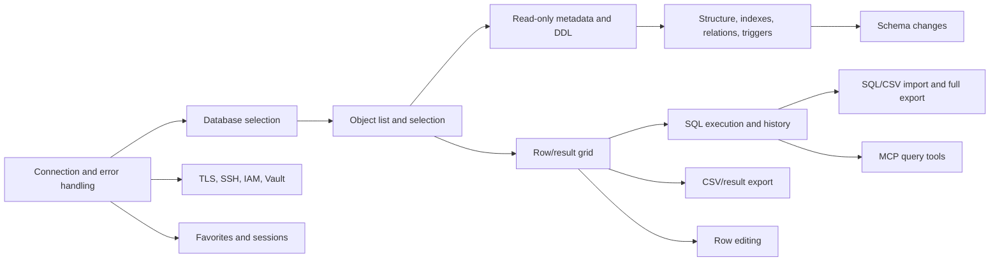

# Sequel Ace feature inventory for the Windows port

This is a **source-based inventory** of the macOS application in this checkout
(version 6.0.3 in `Resources/Plists/Info.plist`). It is a planning checklist,
not a claim that every item has been exercised on a live server. Server version,
database permissions, and selected object type can hide or disable actions.
The installed 5.4.0 app is not a matching runtime reference for this source.

The Windows Rust port currently has TCP/IP connection, optional initial and
manual database selection, database/table filtering and name copying,
table/view column and CREATE SQL inspection, basic server information, refresh,
SQL execution with bounded result grids, session-only query history,
displayed-result CSV copy, and disconnect. It also shows table
size/engine estimates, indexes and foreign keys, plus a process-list shortcut
and a full server-variable view. A read-only Content view now loads 1000 rows
per page, supports previous/next/refresh, and copies the shown page as CSV.
Its Windows and
live-server behavior still needs verification. See
[the parity ledger](windows-port-parity-plan.md) for the evidence standard.
See also the [behavior map](windows-port-behavior-map.md) for source-backed
behavior and gaps in features already implemented.

## Feature groups identified in source

### 1. Connections and favorites

- MySQL/MariaDB connections via standard TCP/IP, local Unix socket, and SSH
  tunnel; AWS IAM token authentication and HashiCorp Vault OIDC credentials.
- Host, port, user, password, optional initial database, time zone, encoding,
  connection timeout, and connection error/cancellation handling.
- SSL/TLS requirements, certificate/key files, public-key retrieval, SSH host,
  port, user, password, key, and remote socket settings.
- Saved connection favorites: add, edit, search, organize, import/export, and
  credential storage in the macOS Keychain.
- Open connections through `mysql://` URLs.

Sources: `Source/Interfaces/ConnectionView.xib`,
`Source/Controllers/MainViewControllers/ConnectionView/`,
`Source/Other/Utility/SAConnectionService.swift`,
`docs/get-started/connection-types.md`.

### 2. Windows, navigation, and database administration

- Multiple connection windows/tabs, duplicate tab, open database/table in a
  new tab or window, navigation history, Navigator, and query console.
- List, select, refresh, and search/filter databases and table objects; table
  pinning and copy table name.
- Add, delete, duplicate (optionally including content), rename, and alter a
  database; select connection encoding and refresh tables/databases.
- Save/open `.spf` connection documents and `.spfs` sessions; open recent files.

Sources: `Source/Interfaces/MainMenu.xib`, `Source/Interfaces/DBView.xib`,
`Source/Controllers/MainViewControllers/SPDatabaseDocument.m`,
`Source/Controllers/SubviewControllers/SPTablesList.m`.

### 3. Tables, views, structure, and metadata

- Add, delete, duplicate (optionally including content), rename, and truncate
  tables; show, copy, and save `CREATE TABLE` SQL.
- Check, repair, analyze, optimize, flush, and checksum table operations.
- Structure view: inspect/add/edit/duplicate/delete fields, types, defaults,
  nullability, auto increment, encoding/collation; filter and sort fields.
- Index management: add/remove indexes, index type, columns, and advanced
  options; reset auto increment.
- Table information, size and row metadata; view objects where supported.

Sources: `Source/Controllers/SubviewControllers/SPTablesList.m`,
`Source/Controllers/MainViewControllers/TableStructure/SPTableStructure.m`,
`Source/Controllers/SubviewControllers/SPIndexesController.m`,
`Source/Controllers/SubviewControllers/SPTableInfo.m`.

### 4. Data, relations, and triggers

- Content grid: load, paginate, sort, simple/advanced rule filtering, reload,
  add/edit/duplicate/delete rows, NULL, long-value popup editor, and binary
  hex display.
- Copy cells/rows normally, with column names, or as SQL `INSERT` (including
  the option to omit auto-increment columns).
- Inspect/add/delete foreign-key relations and choose referenced database,
  table, and column.
- Inspect/add/edit/delete/refresh table triggers.

Sources: `Source/Controllers/MainViewControllers/TableContent/SPTableContent.m`,
`Source/Controllers/MainViewControllers/TableRelations/SPTableRelations.m`,
`Source/Controllers/MainViewControllers/TableTriggers/SPTableTriggers.m`,
`Source/Interfaces/DBView.xib`.

### 5. SQL editor and query records

- Write and execute all SQL, selected SQL, or the current statement; run
  multiple statements and cancel a running operation.
- Results grid, affected-row counts, duration, errors, and `EXPLAIN` for a
  supported single `SELECT`/`WITH` statement.
- Syntax highlighting, completion, editing/search commands, MySQL help,
  open/save SQL file, query console, and query history.
- Query favorites: global or document scope, add/edit/duplicate/delete,
  import/export, tab triggers, and navigable snippet placeholders.

Sources: `Source/Controllers/MainViewControllers/SPCustomQuery.m`,
`Source/Controllers/MainViewControllers/SPCustomQuery+Explain.swift`,
`Source/Controllers/SubviewControllers/SPQueryController.m`,
`docs/queries.md`, `docs/favorites.md`.

### 6. Import, export, and printing

- Import SQL and CSV from files or clipboard; encoding, CSV delimiters,
  quoting/escaping, header detection, field mapping, progress, and SQL error
  handling.
- Export SQL, CSV, XML, and Graphviz DOT. SQL export has structure/content/
  `DROP` options; output source, filename, and encoding are configurable.
- Export selected tables or query results where the format permits; print
  table/query content and other supported views.
- `SPHTMLExporter` and `SPPDFExporter` classes exist, but the active export
  type tab bar exposes SQL/CSV/XML/DOT and the controller rejects HTML/PDF as
  export types. Do not mark HTML/PDF file export as supported from filenames
  or dormant XIB tabs alone.

Sources: `Source/Controllers/DataImport/SPDataImport.m`,
`Source/Controllers/DataExport/SPExportController.m`,
`Source/Interfaces/ExportDialog.xib`,
`Source/Other/Utility/SAPrintUtility.swift`.

### 7. Server tools, preferences, and integrations

- User/host and global/schema privilege management; server variables;
  process list with refresh and kill query/connection; flush privileges and
  server shutdown when allowed.
- Preferences for general UI, editor, tables, network, files, notifications,
  appearance, default view/favorite/encoding, and MCP server.
- Bundles and bundle editor, MySQL and online help, keyboard shortcuts,
  notifications, and a localhost MCP server with read-only default.
- MCP tools for listing connections/databases/objects, schema and DDL,
  executing or explaining queries, sampling/counting rows, exporting results,
  server info, table sizes, and process control; schema resources and prompts.

Sources: `Source/Controllers/SubviewControllers/SPUserManager.m`,
`Source/Controllers/SubviewControllers/SPProcessListController.m`,
`Source/Controllers/Preferences/`, `Source/Controllers/BundleSupport/`,
`docs/get-started/mcp-server.md`.

## Dependency map

The graph shows **implementation dependencies**, not an exact sequence of
macOS releases. In particular:

- Database selection needs a working connection; object details need a selected
  database and object. Safe SQL identifier quoting and clear error states are
  shared foundations for every object-level action.
- A typed result model and grid are shared by table content, arbitrary SQL
  results, CSV export, and most MCP data tools. Pagination and cancellation
  should be settled before loading large tables.
- Editing and destructive operations additionally need server capability/
  privilege checks, transaction/error handling, and refresh rules.
- Favorites can start with non-secret connection settings, but password saving
  requires Windows Credential Manager or an equivalent secure store. `.spf`
  and `.spfs` compatibility requires format fixtures and migration rules.
- TLS, SSH, IAM, and Vault build on connection lifecycle but each has separate
  transport, token, certificate, or operating-system integration work.
- Bundles and MCP depend on stable query APIs; macOS-specific UI and script
  integrations need a separate Windows design before parity can be claimed.

## Smallest useful work from today's Rust baseline

| Order | Feature | Why feasible now | Depends on | Done when |
| --- | --- | --- | --- | --- |
| 1 | Search/filter database and table lists; copy names | Client-side UI over lists already loaded | Existing lists | Exact names preserved; filtering and selection work after refresh |
| 2 | Optional initial database in connection form | `SelectDatabase` request already exists | Connection state and validation | Connect selects it; denied/missing database shows a useful error |
| 3 | Select a table/view and show columns and `CREATE` SQL | A few read-only metadata queries | Object selection, identifier quoting, typed responses | Works for a table and a view; errors do not clear unrelated state |
| 4 | Show server version and basic variables | Read-only query on existing connection | Generic single-result response | MySQL/MariaDB values and permission errors display correctly |
| 5 | Simple SQL editor with result grid | `mysql::Conn` worker can run queries | Typed result model, cancellation plan, multi-statement parsing | `SELECT`, empty results, errors, and large-result bounds work |
| 6 | Query history and CSV result export | Local storage / formatting over query results | SQL editor and result grid | Reopen history; CSV handles NULL, quotes, line breaks, encoding |

Rows 1–4 are relatively small, read-only increments. Row 5 is the next
architectural step; it must precede much of row editing, full import/export,
and MCP. None is marked complete until tested in a Windows executable with a
live MySQL/MariaDB server and compared with a macOS build from the same commit.

Rows 1–5 now have initial Rust UI and worker implementations. Row 6 has
session-only history and clipboard CSV for displayed rows; persistent history
and file export remain. No tests were added or run for the SQL slice at the
user's request. All rows remain **unverified for runtime parity** until the
Windows and live-server checks above pass.

## Later work with broader dependencies

| Feature group | Main additional dependency |
| --- | --- |
| TLS/SSH/AWS IAM/Vault | Driver parity, certificates/SSH transport, token renewal, OS credential/browser flows |
| Row and schema editing | Editable result identity, SQL generation, privilege/capability checks, confirmation and rollback/error behavior |
| SQL/CSV import and full export | Streaming parser/writer, progress/cancel, encoding, error policy, format compatibility |
| Favorites, `.spf`, `.spfs` | Persistent model, format fixtures, secure Windows secret storage, tab/session model |
| Bundles and MCP | Stable query/metadata APIs, permission boundary, local IPC/HTTP, Windows integration |
